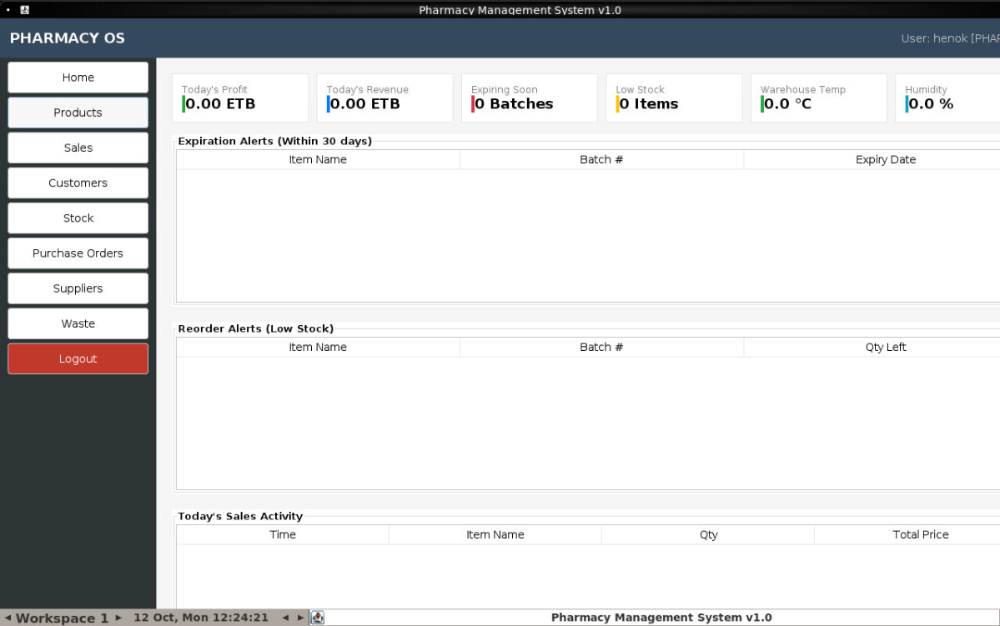
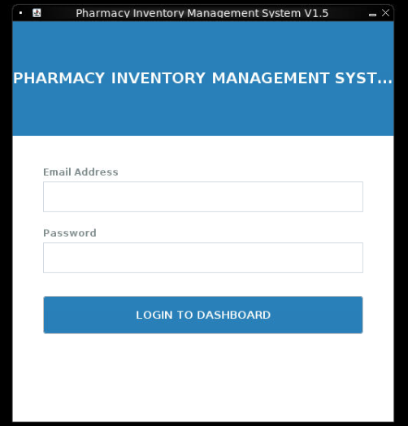

# Pharmacetual Inventory Management System 
<div>


</div>

# 📌 Overview
This project is a pharmaceutal Inventory Management System built for pharmacy item suppliers and pharmacy companies as solution to manage their medicine products and to keep their medicine products.
There are three roles of this system, admin, manager, supplier and cashier based on their roles in the job.This project is done by the students who they call themselves team </Arada>.
# 🛠️ Technologies Used

Java (JDK 17 or 21) <br>
Java Swing – GUI <br>
package manager- Maven <br>
Flatlaf - for styling the ui <br>
Java Springboot - Backend <br>
Mysql - Database <br>
Hardware - Arduino uno <br>
Hardware code - c++

---

# 🐳 Running with Docker (Recommended for any machine)

You can run the entire application along with the MySQL database on **any machine (Windows, macOS, Linux)** using Docker without needing Java, Maven, or MySQL installed locally.

Because this is a Java Swing desktop GUI application, the container includes a lightweight virtual display with **noVNC**, allowing you to interact with the full desktop UI directly from your favorite web browser!

### 1. Prerequisites
- [Docker Desktop](https://www.docker.com/products/docker-desktop/) (Windows / macOS) or Docker Engine + Docker Compose (Linux). Make sure Docker is running.

### 2. Start Application & Database
Open a terminal in the project directory and run:
```bash
docker compose up --build
```

### 3. Access the GUI
Once the containers start up, open your web browser and navigate to:
👉 **[http://localhost:6080](http://localhost:6080)**

The full Swing interface will appear in your browser. Click **Connect** (if prompted) and log in!

### 🔑 Default Login Credentials
| Role | Email | Password |
|---|---|---|
| **Admin** | `admin@pharmacy.com` | `admin123` |
| **Manager** | `manager@pharmacy.com` | `manager123` |
| **Pharmacist** | `pharmacist@pharmacy.com` | `pharmacist123` |
| **Cashier** | `cashier@pharmacy.com` | `cashier123` |

### 4. Direct Database Access (Optional)
The MySQL 8.0 database is also accessible externally on port `3306`:
- **Host**: `localhost`
- **Port**: `3306`
- **Database**: `inventory`
- **Username**: `root`
- **Password**: `root`

### 5. Stop the Application
To stop the containers:
```bash
docker compose down
```
To stop and reset all database data:
```bash
docker compose down -v
```
